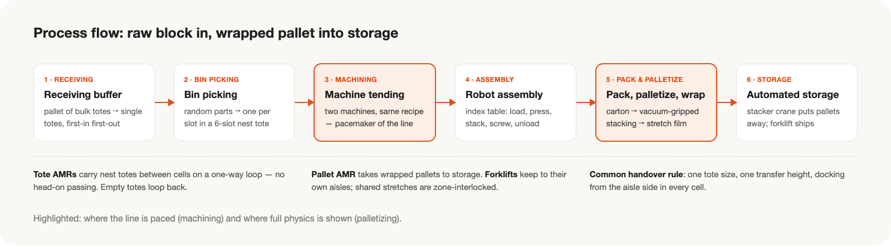
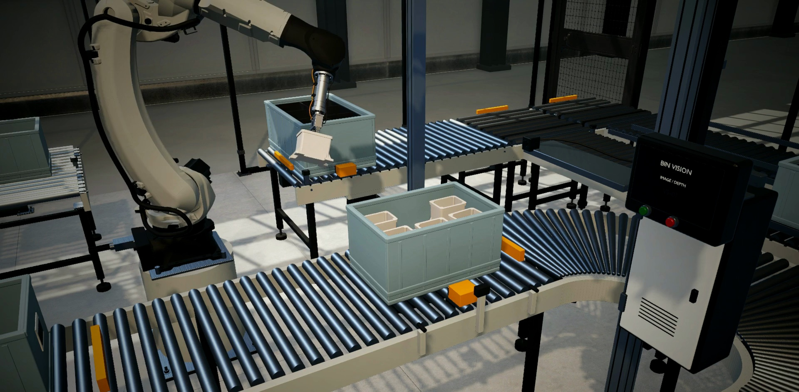
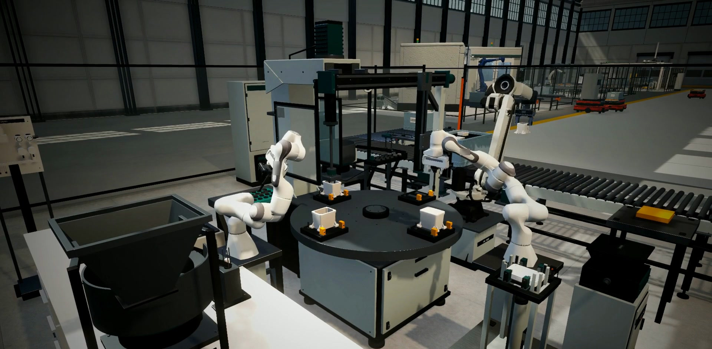
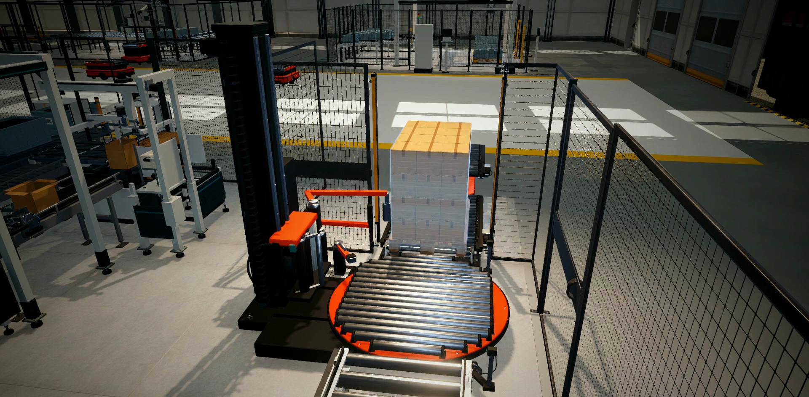
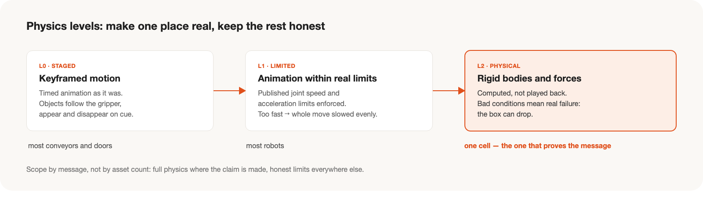
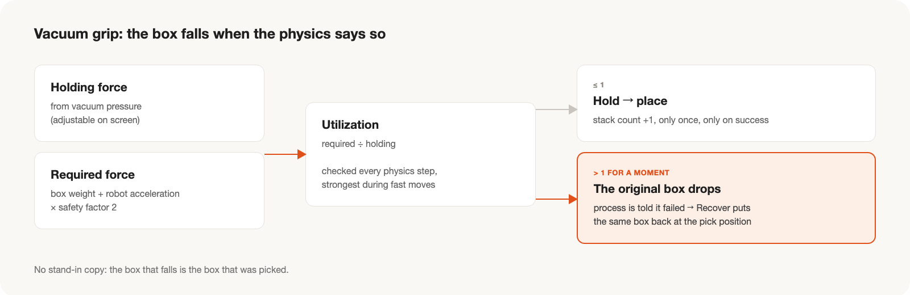

전시 부스에서 상영하고 관람객이 직접 조작해 볼 수 있는 **가상 공장 씬**을 만든 기록입니다.
특정 제조기업의 실제 설비를 옮긴 것이 아니라, 전시를 위해 새로 설계한 부품 가공·조립 공장입니다. 영상 촬영과 편집은 [별도 글](../exhibition-video-capture/)에 정리했습니다.

## Overview

전시의 핵심 메시지는 **"로봇이 물리 법칙에 따라 움직인다"**였습니다.
원소재가 들어와 가공·조립되고, 포장되어 팔레트로 쌓인 뒤 자동창고에 들어가기까지의 흐름을 하나의 씬에서 끊김 없이 보여주는 것을 목표로 했습니다.

- **기간:** 9월 중순 기획 → 10월 둘째 주 완료 (약 4주)
- **환경:** Unity 6 (URP), C#, Blender, Python
- **결과물:** 상시 구동되는 공장 씬, 상태를 보여주는 모니터링 화면, 관람객이 흡착 압력을 조절해 보는 상호작용

## Process

공장은 여섯 개 공정 구역과 이들을 잇는 물류로 구성했습니다.

**1. 원소재 입고 버퍼**
지게차가 원소재 토트를 실은 팔레트를 들여오면, 이를 토트 단위로 풀어 다음 공정에 들어온 순서대로 공급합니다. 팔레트 단위 입고와 토트 단위 소비 사이의 완충 구역입니다.

**2. 비전 빈피킹**
원소재가 무작위로 담긴 토트에서 로봇이 하나씩 집어, 여섯 칸짜리 정렬 토트에 가지런히 담습니다. 자세가 나쁜 부품은 재파지 지그에서 다시 잡습니다.
이 셀의 집기 동작은 미리 정의한 자세를 재생하는 방식이며, 실제 영상 인식이 아닙니다. 화면과 설명도 이 범위 안에서만 표현했습니다.

**3. 가공(머신 텐딩)**
로봇이 정렬 토트에서 소재를 꺼내 가공기 두 대에 장착하고 탈착합니다. 문이 한 번 열릴 때 완성품 배출, 1차 가공품 반전·재장착, 새 소재 장착을 한 번에 처리합니다.
두 가공기는 같은 공정을 모두 수행할 수 있어서, 한 대가 멈추면 다른 대로 작업을 돌리는 상황을 보여줄 수 있습니다. 라인 전체의 속도를 정하는 병목 공정이기도 합니다.

**4. 로봇 조립**
네 개의 스테이션을 가진 회전 인덱스 테이블에서 조립이 진행됩니다. 하우징 로딩 → 인서트 압입 → 내부 부품 적층 → 커버 안착과 나사 체결 → 언로딩 순서이며, 적층과 체결은 협동로봇 두 대가 맡습니다. 완성품은 원래 꺼낸 토트 칸으로 돌아가 추적이 유지됩니다.

**5. 포장·팔레타이징·래핑**
토트의 제품을 카톤에 담아 봉함하고 라벨을 붙인 뒤, 흡착 그리퍼를 단 로봇이 팔레트에 적재합니다. 적재가 끝난 팔레트는 래핑기에서 필름으로 감깁니다.
씬에서 유일하게 **실제 물리 계산**으로 동작하는 구역으로, 전시 메시지를 직접 보여주는 주인공 셀입니다.

**6. 완제품 자동창고**
팔레트 AMR이 완제품 팔레트를 창고 입구로 옮기면 스태커 크레인이 랙에 입고합니다. 출고는 지게차가 맡습니다.

**물류와 모니터링**
- 셀 사이는 토트 AMR, 팔레트 AMR, 지게차가 잇습니다. AMR은 **한 방향 순환로**를 돌게 해 정면 교행이 생기지 않게 했고, 지게차는 전용 통로를 쓰되 공유 구간은 구역 단위로 인터록을 걸었습니다. 비운 토트는 회수 루프를 따라 앞 공정으로 돌아갑니다.
- 모니터링 화면에는 공장 전체 지표, 공정별 탭, 장비 설명창을 두었습니다. 팔레타이징 셀에서는 흡착 압력을 화면에서 직접 조절할 수 있습니다.

## Design Considerations

설계 단계에서 다음 다섯 가지를 기준으로 삼았습니다.

- **공정이 실제로 성립할 것.** 보기 좋은 배치보다 물건이 어떻게 넘어가는지를 먼저 정했습니다. 모든 셀이 같은 토트 규격, 같은 인계 높이, 같은 도킹 방식을 따르는 **공통 인계 규약**을 두었습니다.
- **흐름의 균형.** 가장 느린 가공 공정을 기준으로 앞뒤 공정의 처리 속도와 버퍼를 맞췄습니다. 한 셀만 빠르면 그 앞뒤에 물건이 쌓이거나 비게 됩니다.
- **물리적 근거.** 로봇 동작은 공개된 관절 속도·가속 한계 안에서 움직이게 하고, 근거가 된 자료를 함께 기록했습니다.
- **정직한 표현.** 구현된 것만 보여줍니다. 설계 검토의 판정마다 "확인됨 / 데모용 가정 / 미해결"을 구분해 남겼고, 데모용 가정은 화면에서도 실제 기능처럼 표현하지 않았습니다.
- **관람객의 시선.** 부스 앞에 머무는 시간은 길지 않습니다. 팔레트 적재 수는 한눈에 셀 수 있을 만큼 줄이고, 설비에는 특정 제조사 로고나 상표를 넣지 않은 일반 형상을 썼습니다.

## Challenges and Solutions

**1. 레퍼런스 이미지와 실제 공정의 차이**
- *과제:* AI로 만든 조감도와 셀 이미지는 보기에는 그럴듯했지만, 배치 수치와 대조하자 열두 가지 문제가 드러났습니다. 공정마다 제품 모양이 달랐고, AMR이 물건을 넘겨주는 높이와 방식이 정해져 있지 않았으며, 주행로와 셀의 도킹 방향이 이어지지 않았습니다.
- *해결:* 공통 인계 규약을 먼저 정하고 셀을 다시 설계했습니다. 이미지 수정은 "시점은 유지하고 이 항목만 고친다"는 방식으로 라운드를 나눠 진행했고, 셀별 사양서·데이터·문서를 하나의 스크립트가 생성하게 해 수정 사항이 모든 문서에 함께 반영되도록 했습니다.

**2. 시간 기반 애니메이션에서 물리 기반 동작으로**
- *과제:* 첫 통합 데모는 모든 동작이 시간 기반 애니메이션이었습니다. 상자는 로봇 손끝을 따라 움직이다 나타나고 사라질 뿐, 전시 메시지인 "물리"가 씬 어디에도 없었습니다.
- *해결:* 모든 설비를 한 번에 바꾸는 대신 동작을 세 등급으로 나눴습니다. **L0**은 기존 애니메이션, **L1**은 실제 관절 한계를 지키는 애니메이션, **L2**는 강체와 힘으로 계산되는 실제 물리입니다. 메시지를 직접 증명하는 팔레타이징 셀을 L2로, 대부분의 로봇을 L1으로 맞췄습니다.

**3. 흡착 파지의 물리 모델**
- *과제:* "물리로 움직인다"를 관람객이 체감하려면, 조건이 나빠지면 실제로 실패해야 했습니다.
- *해결:* 진공압으로 유지력을, 상자 무게와 로봇 가속으로 필요력을 계산하고 안전계수를 곱했습니다. 필요력이 유지력을 넘는 상태가 이어지면 상자가 떨어집니다. 떨어지는 것은 집었던 바로 그 상자이며, 복제본으로 대신하지 않습니다. 공정은 실패를 통보받고, 복구하면 같은 상자가 원래 자리로 돌아가며, 적재 수는 실제로 성공했을 때만 올라갑니다.

**4. 비현실적인 로봇 동작**
- *과제:* 일부 로봇은 경유점마다 멈췄다가 출발했고, 빈손으로 돌아갈 때는 제한 없이 빠르게 회전했습니다. 협동로봇은 일부 동작에서 관절 속도 한계를 크게 넘었습니다. 또 상자 무게만 보고 고른 로봇은 적재 지점의 상당수에 팔이 닿지 않았습니다.
- *해결:* 관절 하나라도 한계를 넘으면 동작 전체를 같은 비율로 늘리고, 경유점은 멈추지 않도록 부드럽게 이었습니다. 그 결과 조립 셀은 느려졌지만 그대로 받아들였습니다. 빠르지만 불가능한 동작은 전시 메시지와 정면으로 충돌하기 때문입니다. 팔이 닿지 않는 문제는 받침대 높이와 적재 수, 로봇 체급을 조정하고 모든 적재 지점에서 역기구학이 풀리는지 확인해 해결했습니다.

**5. 공정 교착과 긴 워밍업**
- *과제:* 검사 보류품이 재작업으로 돌아가는 순환에서 대기열이 서로를 기다리며 라인 전체가 멈추는 경우가 있었습니다. 또 빈 공장에서 시작하면 첫 가공 완성품이 나오기까지 20분 넘게 걸려 전시 중 "멈춘 공장"처럼 보였습니다.
- *해결:* 공정 로직의 허점을 반복 점검해 더 이상 새 문제가 나오지 않을 때까지 수렴시켰습니다. 합격·재작업 대기열을 분리하고, 순환 구간에 재공 상한과 무진행 자동 해제를 두었습니다. 워밍업은 첫 배치를 미리 배치해 두는 방식, 연속 투입, AMR 통로 양보를 더해 첫 완성까지의 시간을 절반 이하로 줄였습니다. 화면 지표에서는 미리 배치한 재공과 새로 생산한 수량을 구분해 표시했습니다.

**6. 시뮬레이션의 안정성**
- *과제:* Play를 반복하면 에디터가 종료되는 문제와, AMR이 비어 있는 통로 앞에서 멈추는 문제가 있었습니다.
- *해결:* 앞의 것은 충돌 검사용으로 만든 숨김 복사본이 Play가 끝나도 남아 누적되던 것이 원인이었고, 생성과 해제 시점을 바로잡았습니다. 뒤의 것은 정적 배칭된 칸막이에서 메시를 읽을 때 합쳐진 거대한 메시가 반환되어 수십 미터짜리 가상 벽이 생긴 것이 원인이었고, 렌더러의 월드 경계를 쓰도록 고쳤습니다.

**7. 시각 품질**
- *과제:* 로봇 표면이 깨져 보이고, 화면 전체에 노이즈가 있었으며, 금속과 플라스틱의 구분이 약했습니다.
- *해결:* 원인을 하나씩 바꿔 보는 대조 렌더로 확정한 뒤 고쳤습니다. 표면 깨짐은 하드 노멀과 이음매의 겹침, 노이즈는 앰비언트 오클루전 설정이 원인이었습니다. 텍스처가 없던 재질을 정리하고, 반사 프로브를 베이크 방식으로 바꾸고, 과도하게 무거운 형상을 줄였습니다.

## Lessons

- **보기 좋은 그림보다 공정의 성립이 먼저입니다.** 레퍼런스 이미지는 공정 검토를 따로 거쳐야 설계가 됩니다.
- **진짜는 한 곳에 집중합니다.** 메시지를 증명할 구역에 실제 물리를 쓰고, 나머지는 등급을 정해 정직하게 남깁니다.
- **실패할 수 있어야 물리입니다.** 실패를 숨기지 않고, 실패와 복구 모두를 공정이 알도록 만듭니다.
- **빠르지만 불가능한 동작은 느린 동작보다 해롭습니다.** 근거 있는 한계를 지키는 비용은 받아들입니다.
- **켜는 순간이 아니라 흐르는 상태를 설계해야 합니다.** 워밍업과 지표의 의미까지 함께 설계합니다.
