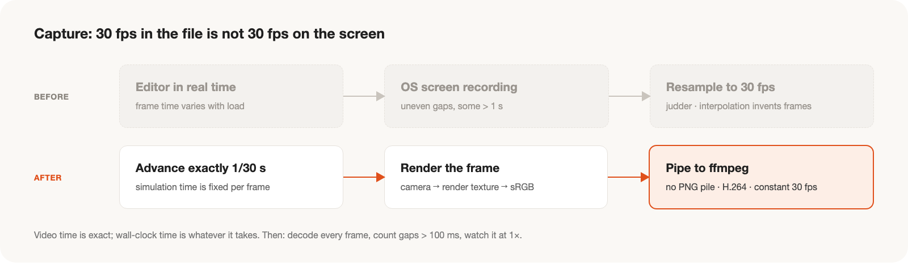

전시용 가상 공장 씬을 촬영해 부스에서 반복 재생할 영상을 만든 기록입니다.
씬의 공정 설계와 물리 기반 동작은 [별도 글](../exhibition-scene-physics/)에, 완성된 장면은 [프로젝트 페이지](../../portfolio/expo-factory-film/)에 있습니다.

## Overview

부스의 대형 화면에서 상시 재생되는 영상입니다. 관람객은 부스 앞을 지나가며 짧게 머물기 때문에, 소리 없이도 어느 지점에서 보기 시작해도 공장의 흐름이 읽히고 끝없이 반복되는 영상을 목표로 했습니다.

- **기간:** 10월 첫째 주 기획 → 둘째 주 승인 (약 1주)
- **방식:** 별도 애니메이션이나 생성형 영상 없이, 돌아가는 시뮬레이션을 엔진 안에서 직접 촬영
- **결과물:** 약 2분 루프 영상과 3분 확장판. 1920×1080, 30fps 고정, H.264, 무음
- **도구:** Unity 6 (URP), C#, ffmpeg, Python

## Production Process

| 단계 | 내용 |
| --- | --- |
| 기획 | 참고 영상 분석, 샷 구성(콘티), 표현 가능한 범위 정리 |
| 파일럿 | 대표 장면 한 컷을 먼저 촬영해 화질·UI·연출 방향 확인 |
| 본 촬영 | 승인된 샷 목록을 고정 스텝 방식으로 촬영 |
| 룩 개발 | 조명·톤매핑·접촉 그림자를 복제한 씬에서 조정 |
| 편집 | 샷 표 기반 스크립트 편집, 색 공간 정리, 루프 이음새 구성 |
| 검수·납품 | 전체 디코딩, 프레임 간격, 정상 속도 재생, 루프 경계 확인 후 마스터·상영본 출력 |

각 단계는 승인을 받은 뒤 다음 단계로 넘어갔고, 승인본은 버전 번호로 고정해 이후 수정은 새 버전으로만 만들었습니다.

## Principles

영상의 신뢰성을 지키기 위해 촬영 전에 다음 원칙을 정했습니다.

- **실제 시뮬레이션만 촬영한다.** 영상에 유리하도록 시뮬레이션 로직, 로봇 제어, 물리 설정을 바꾸지 않는다. 모든 사건은 1배속으로, 리셋·배속·보간 없이 담는다.
- **기존 화면(UI)을 바꾸지 않는다.** 색, 글꼴, 배치는 물론 UI를 잘라내거나 덮는 것도 별도 승인 없이는 하지 않는다.
- **구현되지 않은 기능을 표현하지 않는다.** 영상 인식, 학습, 재계획처럼 실제로 없는 기능은 보여주지 않는다. 예를 들어 빈피킹은 미리 정의한 자세의 재생이며, 가공 장면에는 시간 압축이 적용되어 있다는 점을 제작 문서에 명시했다.
- **생성형 AI로 핵심 동작이나 화면의 숫자를 만들지 않는다.**

## Challenges and Solutions

**1. 촬영 프레임의 불안정**
- *과제:* 처음에는 에디터 화면을 녹화했습니다. 파일은 30fps였지만 프레임 간격을 측정하자 100ms를 넘는 지연이 한 컷에서만 수백 번 나타났고, 1초 넘게 멈춘 구간도 있었습니다. 이를 30fps로 다시 맞추면 화면이 덜컥거렸고, 프레임 보간으로 메우는 것은 없는 장면을 만들어 내는 것이라 원칙에 어긋났습니다.
- *해결:* 엔진 시간을 정확히 1/30초씩 진행시키고 각 프레임이 완성된 뒤 저장하는 **고정 스텝 캡처**로 전환했습니다. 실제 촬영 시간은 영상 길이의 몇 배가 걸리지만, 영상 속 시간은 정확히 30fps로 흐르며 100ms를 넘는 지연은 0이 되었습니다. 이후에는 렌더 결과를 중간 이미지 없이 바로 인코더로 넘겨 저장 공간 부담도 줄였습니다.

**2. UI를 유지하면서 근접 장면 보여주기**
- *과제:* 설비를 가까이 보여주는 장면에서는 모니터링 화면이 시야를 가렸습니다. 그러나 UI를 잘라내거나 덮을 수는 없었고, UI 구성요소를 끄면 카메라가 기본 위치로 돌아가는 부작용이 있었습니다.
- *해결:* 상태는 그대로 두고 **표시와 입력만 끄는** 최소한의 기능을 추가했습니다. 숨긴 상태에서도 클릭 영역과 강조 표시가 실제로 비활성화되는지 확인한 뒤 촬영에 사용했습니다.

**3. 보여줄 장면이 늦게 시작되는 공장**
- *과제:* 공장을 처음 켜면 화면 지표가 0이고, 마지막 공정은 앞 공정이 채워진 뒤에야 시작되어 촬영할 장면이 없었습니다.
- *해결:* 숫자를 조정하는 대신 공장을 그대로 30분간 구동하며 각 장면이 처음 나타나는 시점을 측정하고, 그 시점에 맞춰 촬영 계획을 세웠습니다.

**4. 실제 기능으로 만든 연출**
- *과제:* 원칙상 연출용 애니메이션을 따로 만들 수 없었지만, 단순히 이어 붙인 화면은 "밋밋하다"는 평가를 받았습니다. 생성형 영상으로 오프닝을 시험한 결과도 공장 배치가 바뀌거나 없던 사람·차량이 나타나 쓸 수 없었습니다.
- *해결:* 연출 장면도 시뮬레이션의 실제 기능으로 만들었습니다.
  - 닫힌 곡선을 일정한 속도로 도는 **공장 투어 카메라**로, 시작과 끝이 자연스럽게 이어지게 했습니다.
  - AMR을 뒤에서 따라가는 **추적 카메라와 경로선**을 더했고, 접촉 순간에는 카메라를 고정했습니다.
  - 화면에서 흡착 압력을 실제로 낮춰 **상자가 떨어지고 복구되는 장면**을 담았습니다.
  - 두 AMR이 교차로에서 **서로 양보하는 장면**은 처음 방식에서 서로를 기다리며 멈췄고, 원거리 구도에서는 양보가 읽히지 않았습니다. 위치 공유 방식과 직각 교차 배치로 바꾸고, 가까운 구도로 다시 촬영했습니다.

**5. 평평해 보이는 화면**
- *과제:* "금속과 플라스틱이 구분되지 않는다"는 피드백이 있었습니다. 광원은 많았지만 그림자를 만드는 광원이 하나뿐이어서 형태의 어두운 면이 사라져 있었습니다.
- *해결:* 원본 씬을 보존한 채 복제 씬에서 셀마다 추가 광원과 그림자 수에 예산을 두고 조명을 다시 잡았습니다. 톤매핑은 같은 프레임·같은 카메라로 비교해 골랐습니다. 다른 편집본이 더 선명해 보였던 이유도 측정해 보니 색 보정이 아니라 **구도와 접촉 그림자**의 차이였고, 이를 반영해 다시 촬영했습니다.

**6. 실제 현상과 보이는 현상의 구분**
- *과제:* "창고 크레인이 랙을 관통한다", "그리퍼가 중심에서 비껴 잡는다", "토트가 하나씩만 내려온다"는 지적이 나왔습니다.
- *해결:* 형상의 문제와 보이는 방식의 문제를 나눠 확인했습니다. 크레인은 코드상 레일을 벗어날 수 없었고, 특정 각도에서 포크가 랙 안으로 뻗는 모습이 관통처럼 보인 것이어서 구도를 바꿨습니다. 그리퍼는 좌표 변환 오차 누적과 패드 두께 누락이, 토트는 순차 갱신 구조가 원인이어서 각각 시뮬레이션을 고친 뒤 해당 장면만 다시 촬영했습니다.

**7. 편집과 루프**
- *과제:* 소스마다 색 공간이 달랐고, 디지털 줌인은 미세하게 떨렸습니다. 처음과 끝 장면의 카메라만 맞춘 루프는 그 사이 화면 지표와 AMR 위치가 튀었습니다.
- *해결:* 편집은 컷별 소스와 구간을 적은 **샷 표 하나**로 관리해 언제든 같은 결과를 재현할 수 있게 했습니다. 색 공간은 실제 변환과 태그를 통일하고 이미 변환된 소스는 중복 변환하지 않도록 나눴습니다. 줌인은 프레임마다 소수 배율로 확대하는 방식으로 바꿨습니다. 루프는 **같은 연속 촬영본의 앞뒤 구간**으로 시작과 끝을 구성해 끊김을 없앴습니다. 오디오가 없는 파일을 받지 않는 재생기에 대비해 상영본에는 무음 오디오 트랙을 넣었습니다.

**8. 검수**
- *과제:* 첫 승인본에서 팔레트가 갑자기 나타나는 구간이 발견되어 승인본을 회수했습니다. 또 기록상으로는 성공했지만 대상이 화면 밖에 있거나, 결과 화면이 너무 짧아 읽을 수 없는 컷도 있었습니다.
- *해결:* 화면을 작은 블록으로 나눠 프레임 간 차이를 측정하는 방식으로 전체를 다시 점검하고, 문제가 없는 구간으로 재편집했습니다. 검수는 **파일 확인 → 전체 디코딩 → 프레임레이트와 프레임 간격 → 정상 속도 재생 → 루프 경계 반복 확인** 순으로 고정하고, 결과를 통과·부분 통과·실패·미검증으로 기록했습니다. 전시장 장비에서의 재생처럼 확인하지 못한 항목은 미검증으로 남겼습니다.

## Lessons

- **기록상의 30fps와 실제 촬영의 30fps는 다릅니다.** 프레임 간격을 직접 측정하고, 측정 가능한 소스를 먼저 확보합니다.
- **제약이 연출을 만듭니다.** 실제 기능만 쓸 수 있다는 조건이 투어 카메라, 압력 시연, 양보 장면 같은 설득력 있는 장면으로 이어졌습니다.
- **시뮬레이션이 해낸 일과 화면에 읽히는 일은 다릅니다.** 구도로 증명해야 관람객에게 전달됩니다.
- **룩 → 주광 방향 → 카메라 순서로 정합니다.** 조명이 바뀌면 좋은 구도도 바뀝니다.
- **판정은 화면에 실제로 담긴 것으로 합니다.** 확인하지 못한 것은 확인하지 못했다고 기록합니다.
