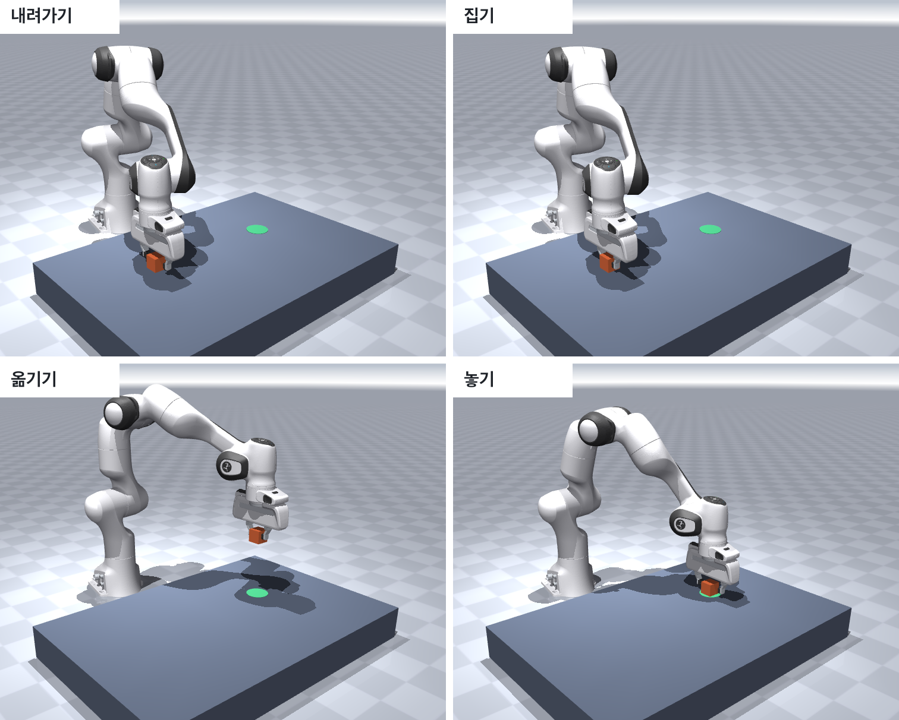
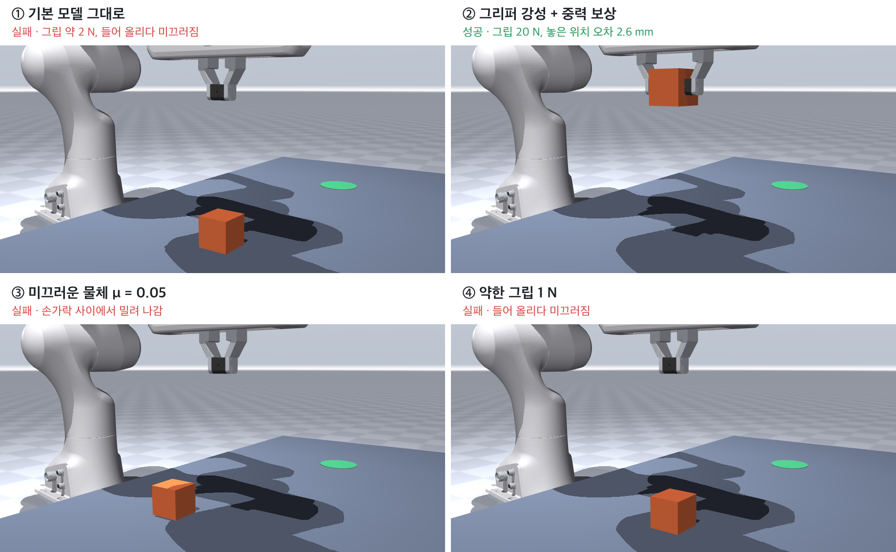
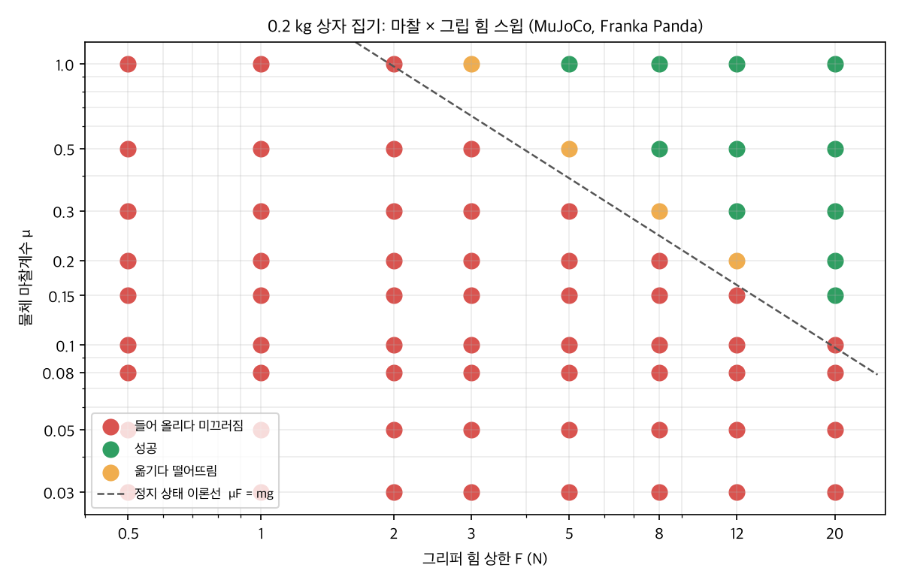

import pickSuccess from './pick-success.mp4';
import pickLowFriction from './pick-low-friction.mp4';

3D 장면에서 로봇이 물건을 옮기는 것처럼 보이게 하는 가장 쉬운 방법은 **물건을 손에 붙이는 것**입니다. 손이 닿는 순간 물건을 손의 자식으로 만들고, 내려놓을 때 떼면 됩니다. 절대 실패하지 않습니다.

그래서 쓸모가 없습니다. 실제 로봇은 물건을 놓치기 때문입니다. 이번에는 붙이는 코드를 하나도 쓰지 않고, 로봇에게 **관절 목표값과 그리퍼 목표값만** 보냈습니다. 상자가 따라오는지는 물리 엔진이 접촉과 마찰로 결정합니다.

[학습 사다리](/posts/physical-ai-terms/)로 보면 이 실험은 1~2단계입니다. 상자 위치에서 경유점을 정하고 역기구학으로 푼 것이지, 학습한 것은 없습니다.

<video src={pickSuccess} controls muted loop playsinline preload="metadata" width="1152" height="720" style={{ width: "100%", height: "auto" }} aria-label="Franka Panda가 상자를 집어 초록 표시 위에 놓는 시뮬레이션 (8초)"></video>

## Setup

- **물리 엔진**: MuJoCo 3.17 (Python 바인딩), 맥에서 실행
- **로봇**: [MuJoCo Menagerie](https://github.com/google-deepmind/mujoco_menagerie)의 Franka Emika Panda (7축 팔 + 평행 그리퍼, Apache-2.0)
- **물체**: 한 변 4 cm, 0.2 kg 상자. 작업대 위 왼쪽에서 집어 40 cm 오른쪽의 초록 표시 위에 놓습니다.
- **주기**: 물리 계산 500 Hz, 목표값 갱신 50 Hz

## How It Works

**1. 손끝 위치를 관절 각도로 바꿉니다(IK).**
손끝(두 손가락 패드의 가운데)이 지나갈 경로를 직선으로 정하고, 매 목표 갱신마다 역기구학으로 관절 각도를 구합니다.
자코비안을 이용한 감쇠 최소제곱(damped least squares)으로, 위치와 함께 "손가락이 아래를 향한다"는 자세도 같이 맞춥니다.

```python
# e = [위치 오차, 자세 오차], J = 손끝의 6×7 자코비안
dq = J.T @ np.linalg.solve(J @ J.T + 1e-4 * np.eye(6), e)
q = np.clip(q + dq, joint_min, joint_max)
```

**2. 목표값만 보냅니다.**
구한 관절 각도를 팔의 위치 서보에, 열림·닫힘 값을 그리퍼에 보냅니다. 로봇의 자세를 직접 바꾸지 않으니 순간이동도 없습니다. 서보가 힘을 내서 따라가고, 따라가지 못하면 오차가 남습니다.

**3. 결과는 물리로 판정합니다.**
상자가 3 cm 이상 들렸는지, 마지막에 목표 지점 2 cm 안에 놓였는지를 로그로 판정합니다. 실패하면 어느 단계에서 놓쳤는지(들어 올리다, 옮기다)도 남깁니다.



## First Run Failed

처음에는 Menagerie 모델을 그대로 썼습니다. 손가락은 상자에 닿았고 상자를 감쌌지만, 팔이 올라가자 상자는 그 자리에 남았습니다.

로그를 보니 손가락이 상자를 누르는 힘이 **합쳐서 2 N 남짓**이었습니다. 원인은 그리퍼의 구동 방식이었습니다.

- 이 모델의 그리퍼는 "손가락 간격 목표값"을 따라가는 위치 서보이고, 강성이 100 N/m입니다. 한 힘줄(tendon)이 두 손가락에 힘을 반씩 나눕니다(모델 README에 적혀 있습니다).
- 완전히 닫으라고 명령해도, 4 cm 상자에 막히면 목표와의 차이는 2 cm입니다. 100 N/m × 0.02 m = **2 N**. 0.2 kg 상자의 무게가 약 2 N이니 거의 버티지 못합니다.

실제 평행 그리퍼는 대개 "힘 상한까지 꽉 쥐는" 방식이라, 강성을 2,000 N/m로 올리고 힘 상한을 20 N으로 두었습니다. 닫힘 명령을 내리면 상한까지 쥐게 됩니다.

**팔도 몇 mm씩 처져 있었다**
가만히 세워 두어도 손끝이 목표보다 6 mm 낮고 3 mm쯤 몸 쪽에 있었습니다. 위치 서보만으로는 팔 무게를 버티는 만큼 오차가 남기 때문입니다. 실제 로봇 제어기는 중력을 계산해서 미리 상쇄하므로, 팔 링크에 중력 보상을 켰습니다.

여기서 하나 걸렸습니다. 컴파일된 모델의 `model.body_gravcomp` 값을 바꿨는데 아무 효과가 없었습니다. 수동 힘(`qfrc_passive`)을 찍어 보니 0이었습니다. 이 버전에서는 **컴파일 전에** 모델 명세(`MjSpec`)에서 설정해야 적용됐습니다.

```python
spec = mujoco.MjSpec.from_file('pick_scene.xml')
for b in spec.bodies:
    if b.name.startswith('link') or b.name in ('hand', 'left_finger', 'right_finger'):
        b.gravcomp = 1.0      # 컴파일 뒤에 바꾸면 적용되지 않았다
model = spec.compile()
```

중력 보상 후 정지 상태 관절 오차는 0이 됐고, 상자를 놓은 위치의 오차는 **2.6 mm**였습니다.

## Failure Conditions

같은 셀에서 조건만 바꿔 봤습니다.



- **① 기본 모델 그대로**: 그립 힘이 약해 들어 올리는 순간 미끄러짐.
- **② 그리퍼 강성 + 중력 보상**: 성공.
- **③ 미끄러운 물체(마찰계수 0.05)**: 손가락이 닫히는 순간 상자가 옆으로 밀려 나갔습니다. 집기 전에 이미 실패합니다.
- **④ 약한 그립(힘 상한 1 N)**: 들어 올리다 미끄러짐.

③을 영상으로 보면, 손가락이 닫히는 순간 상자가 한쪽으로 밀려 나가고 팔은 빈손으로 계획대로 움직입니다. 로봇은 상자를 놓쳤다는 것을 모릅니다. 놓친 것을 알아채는 일은 지금은 판정 코드만 하고 있습니다.

<video src={pickLowFriction} controls muted loop playsinline preload="metadata" width="1152" height="720" style={{ width: "100%", height: "auto" }} aria-label="마찰계수 0.05인 상자가 손가락 사이에서 밀려 나가고 팔이 빈손으로 움직이는 시뮬레이션 (8초)"></video>

**마찰값은 어느 쪽 것이 쓰이나**
MuJoCo는 두 물체가 닿으면 기본적으로 두 마찰계수 중 **큰 값**을 씁니다. 손가락의 마찰계수가 1이면 상자에 0.05를 넣어도 아무 일도 일어나지 않습니다.
그래서 상자에 `priority="1"`을 주어 상자 쪽 값이 이기게 했습니다. 대신 작업대와의 접촉에도 상자 값이 쓰이므로, ③은 "어디에 닿아도 미끄러운 상자"에 가깝습니다.

## Friction × Grip Sweep

마찰계수 9단계와 그립 힘 상한 8단계를 조합해 72번 돌렸습니다. 한 번에 1초가 안 걸려서 스윕이 부담 없습니다.



점선은 정지 상태에서 상자가 미끄러지지 않을 최소 조건입니다. 두 손가락이 각각 F/2로 누르므로 마찰력의 합은 μF이고, 이것이 무게 mg(약 1.96 N)보다 커야 합니다.

- **들어 올리기 실패(빨강)의 경계는 이론선과 거의 일치했습니다.** μF가 2.0 N 이하인 조합은 모두 들어 올리다 미끄러졌고, 2.4 N부터는 들렸습니다.
- **그런데 들었다고 끝까지 옮기는 것은 아니었습니다(주황).** μF가 2.4~3.0 N인 조합은 대부분 들어 올린 뒤 옮기는 도중에 떨어뜨렸고(3.0 N은 한 번 성공, 한 번 실패), 3.6 N 이상은 모두 끝까지 옮겼습니다. 이론선의 **약 1.5~1.8배**입니다.

**왜 옮기다 떨어뜨렸나**
떨어진 경우를 다시 돌려 상자의 기울기를 재 보니, 떨어지기 전에 상자가 손가락 사이에서 **약 96° 돌아가 있었습니다.** 성공한 경우는 2° 이내였습니다. 떨어진 시점은 운반 후반, 팔이 감속하는 구간이었습니다.

손가락 패드는 1.7 cm 정도로 작고, 상자는 패드를 축으로 돌 수 있습니다. 미끄러지지 않을 만큼은 쥐고 있어도, 감속할 때 생기는 회전을 막을 만큼은 아니었던 것으로 보입니다.
이 해석은 기울기 측정 하나에 기댄 것이라, 패드 크기나 접촉 모델(`condim`)을 바꿔서 확인하는 것이 다음 할 일입니다.

## Lessons

- **붙이지 않으면 실패할 수 있고, 그래서 의미가 있습니다.** 첫 실행에서 실패한 덕분에 그리퍼 구동 방식을 처음으로 제대로 읽었습니다.
- **공개 모델의 기본값이 내 과제에 맞는다는 보장은 없습니다.** 그리퍼 강성, 중력 보상 모두 과제에 맞게 손봐야 했습니다.
- **"들 수 있다"와 "옮길 수 있다"는 다른 조건입니다.** 정지 상태 이론은 첫 번째만 알려줍니다. 움직이는 동안 버티려면 여유가 더 필요했습니다.
- **엔진이 값을 어떻게 합치는지 알아야 실험이 실험이 됩니다.** 마찰 결합 규칙을 몰랐다면 ③은 아무것도 바뀌지 않은 실험이었습니다.

## Next

- 기울기가 시작되는 순간을 더 자세히 보고, 패드 크기·비틀림 마찰을 바꿔 경계가 움직이는지 확인
- 이번 실험의 마찰계수와 질량을 실제로는 어디서 가져와야 하는지 → [3편: 물성값을 넣기 전에 엔진이 읽는 법부터 확인해야 했습니다](/posts/physics-parameter-sources/)
- 사람이 관절을 움직여 동작을 가르치고 재생하는 teach 모드, 그리고 그것이 모방학습과 어떻게 다른지
