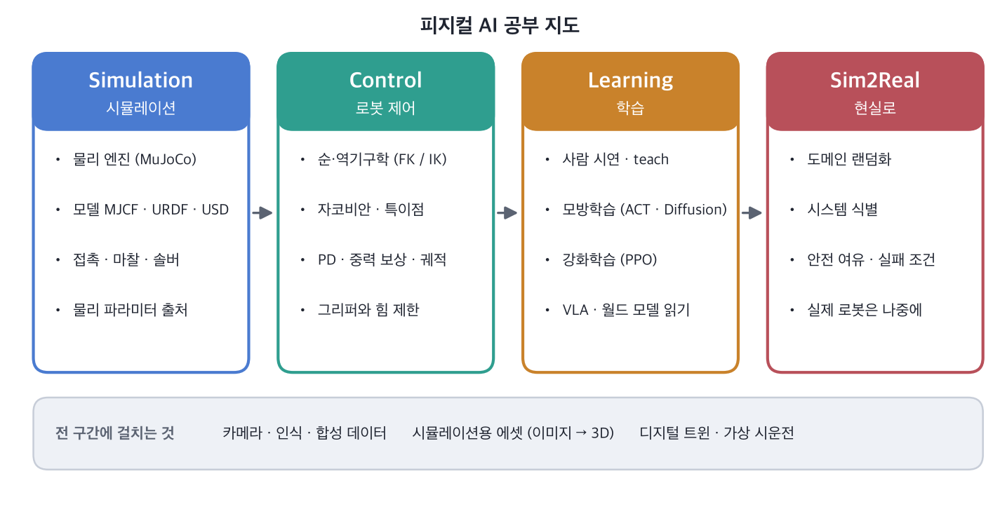

피지컬 AI 자료를 읽기 시작하면 월드 모델, VLA, sim2real, 도메인 랜덤화 같은 말이 한꺼번에 쏟아집니다.
처음에는 다 비슷하게 들려서, 각각이 **어느 층에서 무슨 일을 하는지**로 나눠 정리했습니다.
공부하면서 계속 고쳐 갈 노트입니다.

## What Physical AI Means

언어 모델이 글을 다룬다면, 피지컬 AI는 **센서로 세상을 보고 몸(로봇)으로 행동하는 AI**입니다.
화면 속 AI와 가장 다른 점은 실수가 물리적으로 일어난다는 것입니다. 물건을 떨어뜨리고, 부딪치고, 되돌릴 수 없습니다.
그래서 실제 로봇에 올리기 전에 시뮬레이션에서 충분히 시험하고, 데이터를 만드는 일이 큰 비중을 차지합니다.

## Four Layers

**월드 모델 (World model)**
- "지금 이렇게 하면 다음에 세상이 어떻게 될까"를 예측하는 모델입니다.
- 영상을 생성하는 모델이 물리를 흉내 내기 시작하면서, 학습용 장면을 만들어 주는 용도로도 쓰입니다.
- 물리 엔진이 방정식으로 계산한다면, 월드 모델은 데이터에서 배운 감으로 예측합니다. 둘은 경쟁이라기보다 서로를 보완하는 쪽으로 쓰입니다.

**행동 모델 (VLA, Vision-Language-Action)**
- 카메라 이미지(Vision)와 "빨간 컵을 집어"라는 지시(Language)를 받아, 관절을 어떻게 움직일지(Action)를 내는 모델입니다.
- 언어 모델처럼 큰 모델을 로봇 행동 데이터로 학습시키는 흐름입니다. 2023년의 RT-2 이후 OpenVLA, π0 같은 모델이 나왔습니다.
- 한 종류의 로봇이 아니라 여러 로봇의 데이터를 함께 학습하는 것을 **크로스 임보디먼트(cross-embodiment)**라고 부릅니다.

**시뮬레이터 (Simulator)**
- 중력, 접촉, 마찰을 계산해 로봇과 물체가 어떻게 움직이는지 재현합니다.
- 대표적으로 MuJoCo(오픈소스, 접촉 계산이 정확하고 가벼움), NVIDIA Isaac Sim / Isaac Lab(GPU로 대량 병렬, 사실적 렌더), Genesis 같은 것이 있습니다.
- 강화학습은 수백만 번의 시도가 필요해서, 시뮬레이터를 얼마나 빠르게 많이 돌릴 수 있는지가 중요합니다.

**엣지 컴퓨트 (Edge compute)**
- 학습은 데이터센터에서 해도, 실행은 로봇 위에서 실시간으로 해야 합니다. 네트워크가 끊겨도 로봇은 멈추면 안 되기 때문입니다.
- 그래서 큰 모델을 로봇에 실을 수 있게 줄이는 일과, 로봇용 GPU 보드가 함께 발전하고 있습니다.

실제로는 층이 겹칩니다. 월드 모델이 시뮬레이터 역할을 일부 하기도 하고, 행동 모델 안에 예측 기능이 들어가기도 합니다. 이 그림은 공부용 지도입니다.

## Sim2Real

시뮬레이션에서 잘되던 것이 실제 로봇에서는 안 되는 차이를 **sim2real gap**이라고 합니다.
마찰, 질량, 모터 지연, 카메라 노이즈가 조금씩 다르기 때문입니다.

- **도메인 랜덤화(domain randomization):** 시뮬레이션의 마찰·질량·조명·색을 일부러 매번 바꿔서, 그 범위 안 어딘가에 실제가 있기를 기대하는 방법입니다.
- 공부하며 정리한 관점: 도메인 랜덤화는 **견고성을 시험하는 도구**이지, 실제 데이터를 대신하는 도구는 아닙니다.
- 시뮬레이터를 끝없이 사실적으로 만들기보다, "이 작업에 필요한 만큼의 충실도"를 정하는 것이 현실적이라는 의견이 많습니다.

## Digital Twin vs Simulator

둘을 같은 말로 쓰는 경우가 많아서 헷갈렸습니다. 지금 이해한 차이는 이렇습니다.

| | 디지털 트윈 | 로봇 시뮬레이터 |
| --- | --- | --- |
| 대상 | 특정 공장·설비 하나 | 로봇과 물체의 일반적인 물리 |
| 연결 | 실제 설비의 데이터와 이어짐 | 실제와 연결되지 않아도 됨 |
| 주 용도 | 모니터링, 가상 시운전, 계획 | 학습 데이터 생성, 정책 검증 |

디지털 트윈 안에 물리 시뮬레이터가 들어가면, 공장 단위에서 로봇 정책을 시험할 수 있게 됩니다. 제가 두 주제를 같이 공부하는 이유이기도 합니다.

## Why Data Is the Bottleneck

언어 모델은 인터넷의 글을 학습했지만, 로봇 행동 데이터는 인터넷에 쌓여 있지 않습니다.
"이 장면에서 로봇이 관절을 이렇게 움직였다"는 **관측-행동 쌍**은 누군가 직접 만들어야 합니다.

- 사람이 원격으로 로봇을 조종해 시연을 모으는 방법(텔레오퍼레이션)
- 시뮬레이터에서 자동으로 대량 생성하는 방법
- 사람이 하는 영상에서 배우는 방법

여러 기관의 로봇 데이터를 모은 Open X-Embodiment 같은 공개 데이터셋이 나온 것도 이 병목 때문입니다.

## Learning Ladder

로봇이 "똑똑해지는" 단계를 이렇게 나눠 보면 지금 어디에 있는지 보입니다.

1. **재생:** 정해진 경로를 그대로 움직입니다.
2. **재계획:** 물체가 옮겨지면 역기구학(IK)으로 경로를 다시 계산합니다. 똑똑해 보이지만 학습은 아닙니다.
3. **시연 수집:** 사람이 보여준 관측-행동 데이터를 모읍니다.
4. **모방 학습:** 시연을 따라 하는 정책을 학습합니다.
5. **강화 학습:** 시뮬레이션에서 보상을 주며 정책을 다듬습니다.

2단계의 성공을 "AI가 일반화했다"고 부르지 않도록, 앞으로의 글에서는 각 실험이 어느 단계인지 먼저 적겠습니다.

## Study Map

용어를 정리하고 나서, 무엇을 어떤 순서로 공부할지 지도를 그렸습니다. 앞의 네 층이 "무엇이 있는가"라면, 이 지도는 "무엇부터 할 것인가"입니다.

- **Simulation**: 물리 엔진이 질량·접촉·마찰을 어떻게 계산하는지, 그 값은 어디서 오는지.
- **Control**: 손끝 위치를 관절 각도로 바꾸는 역기구학, 자코비안과 특이점, 위치 서보와 중력 보상. 학습 이전에 사람이 짠 규칙으로 로봇을 움직이는 기본기입니다.
- **Learning**: 위 학습 사다리의 3~5단계. 사람 시연, 모방학습, 강화학습. VLA와 월드 모델은 직접 학습시키기보다 논문을 읽고 정리합니다.
- **Sim2Real**: 실제 로봇이 없으니 당분간은 시뮬레이션 안에서 "현실이 달라지면 어떻게 되나"를 실험합니다.

아래 띠는 네 단계에 모두 걸치는 주제입니다. 디지털 트윈과 가상 시운전도 여기에 넣었습니다. 피지컬 AI가 학습하고 검증받는 무대이기 때문입니다.

## Tools

맥에서 공부하므로 도구도 맥에서 돌아가는지가 먼저입니다.

| 도구 | 쓰는 곳 | 메모 |
| --- | --- | --- |
| MuJoCo | 물리 시뮬레이션 | `pip install mujoco` 한 줄로 맥에서 바로 동작. 첫 실험은 여기서 |
| MuJoCo Menagerie | 공개 로봇 모델 | Franka Panda, UR 등. 만든 과정과 라이선스가 README에 정리되어 있음 |
| Robotics Toolbox (Python) | 기구학 공부 | FK/IK, 자코비안 |
| Gymnasium | 강화학습 환경 | MuJoCo 환경과 함께 씀 |
| LeRobot | 모방학습 | 데이터셋 형식과 정책 구현 |
| Isaac Sim / Isaac Lab | 대규모 병렬 시뮬레이션 | NVIDIA GPU가 필요하고 macOS를 지원하지 않음. 필요해지면 클라우드로 |

## Next

첫 실험은 MuJoCo에서 로봇 팔로 상자를 집어 옮기는 것입니다. 물체를 손에 붙이지 않고, 관절 목표값만 보내서 접촉과 마찰로 집히게 만듭니다.
→ [2편: 상자를 손에 붙이지 않고 집어 보니, 들 수 있는 것과 옮길 수 있는 것은 달랐습니다](/posts/mujoco-pick-cell/)
