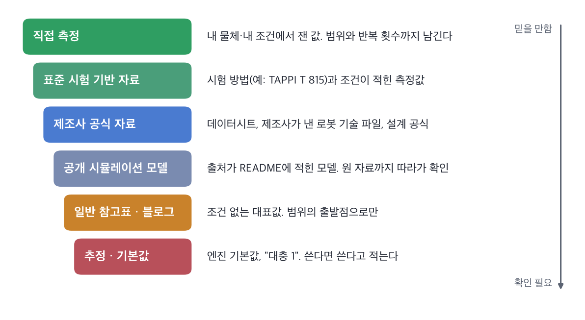

[2편의 실험](/posts/mujoco-pick-cell/)에서 상자를 끝까지 옮기려면 마찰계수 × 그립 힘(μF)이 약 3.6 N은 되어야 했습니다.
그런데 그 μ는 제가 정한 값입니다. 상자가 실제로 골판지인지 플라스틱인지, 젖었는지에 따라 같은 셀이 성공하기도 실패하기도 합니다.

시뮬레이션은 계산은 정확하게 하지만, 넣은 값이 틀리면 정확하게 틀립니다. 그래서 값을 어디서 가져오고 얼마나 믿을지를 정리했습니다.

## Where Values Come From

**표준 시험 기반 자료**
같은 마찰계수라도 어떻게 쟀는지가 적혀 있어야 다른 값과 비교할 수 있습니다.
예를 들어 포장재의 정지 마찰계수를 재는 [TAPPI T 815](https://imisrise.tappi.org/TAPPI/Products/01/T/0104T815.aspx)는 경사면 방식입니다. 한 시편 위에 다른 시편을 올리고 경사를 일정한 속도로 올려서 미끄러지기 시작하는 각도를 재고, 그 탄젠트를 정지 마찰계수로 씁니다.
골판지는 골 방향에 따라 값이 다를 수 있어서 시험할 때 방향을 기록하게 되어 있습니다. 논문이나 자료에서 값을 가져올 때는 **시험 방법, 방향, 반복 횟수, 편차**를 같이 가져옵니다.

**제조사 공식 자료**
로봇의 링크 질량, 관절 한계, 그리퍼 힘처럼 제품에 딸린 값은 제조사 자료가 가장 확실합니다.
다만 제조사는 자기 제품의 값만 줍니다. 흡착 그리퍼 제조사 [Schmalz의 설명](https://www.schmalz.com/en/vacuum-knowledge/the-vacuum-system-and-its-components/system-design-calculation-example/theoretical-holding-force-of-a-suction-cup)도 흡착 패드와 공작물 사이 마찰계수는 **일반적으로 통하는 값을 정할 수 없다**고 하고, 젖은 면 0.2~0.3, 나무·금속·유리·돌 0.5, 거친 면 0.6 같은 참고값만 제시합니다. 다공성 재료는 직접 흡착 시험을 해 보라고 합니다.

**공개 시뮬레이션 모델**
지난 실험에서 쓴 MuJoCo Menagerie의 Franka Panda는 [README](https://github.com/google-deepmind/mujoco_menagerie/tree/main/franka_emika_panda)에 만든 과정이 적혀 있습니다.
- 관성 파라미터는 Franka의 공개 저장소(franka_ros)에 있는 값에 맞췄다고 되어 있습니다. 원 출처까지 따라갈 수 있는 값입니다.
- 그리퍼 구동기는 원래 URDF에 없어서 Menagerie가 추가한 것입니다. 지난 실험에서 그립 힘이 2 N밖에 안 나온 것은 이 추가된 부분의 기본값 때문이었습니다.

같은 모델 안에서도 **제조사에서 온 값과 모델 제작자가 정한 값이 섞여 있습니다.** README를 읽으면 어느 쪽인지 구분할 수 있습니다.

**일반 참고표, 추정값**
조건 없이 "고무 0.8, 강철 0.5" 식으로 적힌 표는 범위를 잡는 출발점으로만 씁니다. 엔진 기본값을 그대로 쓸 때는 기본값을 썼다고 적어 둡니다. 나중에 결과가 이상할 때 가장 먼저 의심할 곳이 됩니다.

## How the Engine Reads Them

값을 제대로 가져와도 엔진이 다르게 해석하면 소용없습니다. MuJoCo에서 확인한 것들입니다.

- **두 물체의 마찰은 합쳐서 하나가 됩니다.** 기본 규칙은 두 값 중 **큰 값**입니다. 손가락 마찰이 1이면 상자에 0.05를 넣어도 접촉에는 1이 쓰입니다. 한쪽 값을 쓰게 하려면 `priority`를 줍니다. 강성·감쇠(`solref`, `solimp`)는 같은 우선순위면 가중 평균입니다. ([MuJoCo 문서](https://mujoco.readthedocs.io/en/stable/modeling.html))
- **정지 마찰과 운동 마찰을 따로 넣는 칸이 없습니다.** 접촉 마찰은 미끄럼·비틀림·구름 세 계수입니다. 자료에 정지·운동 마찰계수가 따로 있으면 어느 쪽을 쓸지 정하고 적어 둡니다. 물건을 놓치는지가 관심이라면 미끄러지기 시작하는 정지 마찰 쪽이 기준이 됩니다.
- **비틀림 마찰은 기본으로 꺼져 있습니다.** 접촉 차원(`condim`) 기본값 3은 미끄럼 마찰만 계산합니다. 지난 실험에서 상자가 손가락 사이에서 돌아간 것과 관련이 있을 수 있어서, 다음에 확인할 항목입니다.
- **접촉은 부드럽습니다.** MuJoCo의 접촉은 아주 약간 겹치는 것을 허용하는 연성 접촉입니다. 이 덕분에 계산이 안정적이지만, 경계 근처에서는 현실의 딱딱한 접촉과 다르게 움직일 수 있습니다.

## Safety Margins

지난 실험에서 정지 상태 이론선(μF = mg)은 **들어 올릴 수 있는지**는 잘 맞혔지만, 옮기는 동안 버티려면 그 1.5~1.8배가 필요했습니다.

현장에서는 이 여유를 처음부터 계산에 넣습니다. 흡착 그리퍼 설계에서는 필요한 힘에 안전계수 S를 곱하는데, Schmalz는 매끈하고 치밀한 공작물은 **1.5 이상**, 거칠거나 다공성이거나 기름 묻은 공작물은 **2.0 이상**, 공작물을 돌리면서 옮길 때는 2.5 이상을 권합니다.
옆으로 옮기는 경우의 공식에는 가속도 a가 마찰계수 μ로 나뉘어 들어갑니다: F = m × (g + a/μ) × S. 마찰이 작을수록 가속에 필요한 힘이 빠르게 커집니다.

시뮬레이션에서 얻은 1.5~1.8배라는 숫자가 이 권장값들과 비슷한 범위인 것은 흥미롭지만, 제 실험은 평행 그리퍼였고 상자 하나, 경로 하나였습니다. 같은 이유라고 말하려면 더 많은 조건에서 확인해야 합니다.

## Ranges, Not Values

값 하나를 고르는 대신 **범위**로 기록하면 쓸모가 생깁니다.

| 항목 | 값 | 출처 | 신뢰도 | 메모 |
| --- | --- | --- | --- | --- |
| 상자 질량 | 0.2 kg | 실험 설정 | 정한 값 | 실제 물체라면 저울로 |
| 상자 마찰계수 | 0.5 ~ 1.0 | 참고표 수준 | 낮음 | 직접 측정 전까지 범위로 |
| 그립 힘 상한 | 20 N | 실험 설정 | 정한 값 | 실제 그리퍼라면 데이터시트 |
| 팔 링크 관성 | 모델 값 | Menagerie ← franka_ros | 높음 | README로 원 출처 확인 |
| 그리퍼 강성 | 2,000 N/m | 직접 수정 | 정한 값 | Menagerie 기본값은 100 |

범위가 있으면 지난 실험의 스윕처럼 **범위 전체에서 되는지**를 볼 수 있습니다.
그립 힘이 20 N이면 마찰계수가 0.15만 넘어도 성공했으니 μ가 0.5인지 1.0인지는 상관없었습니다. 반면 그립 힘이 5 N이면 0.5에서는 실패하고 1.0에서는 성공했습니다. **불확실한 값이 결과를 바꾸는 구간에 있는지**를 먼저 보면, 어떤 값을 정확히 재야 하는지가 정해집니다.

이렇게 일부러 값을 흔들어 학습시키는 것이 Sim2Real에서 말하는 도메인 랜덤화입니다. 로드맵의 뒤쪽에서 다시 다룹니다.

## Next

- 집에 있는 물건으로 경사면 마찰 측정을 직접 해 보고, 측정값으로 집기 셀을 다시 돌리기
- 비틀림 마찰(`condim` 4·6)을 켜면 "옮기다 떨어뜨림" 경계가 움직이는지 확인
