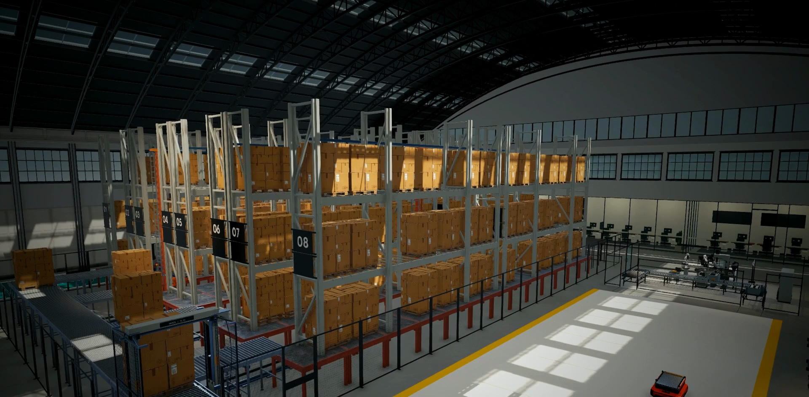
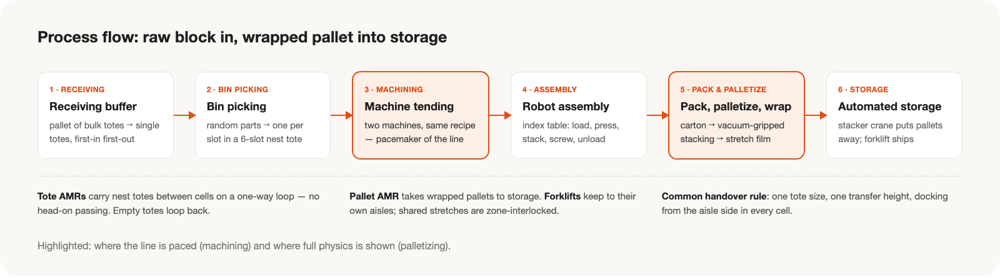
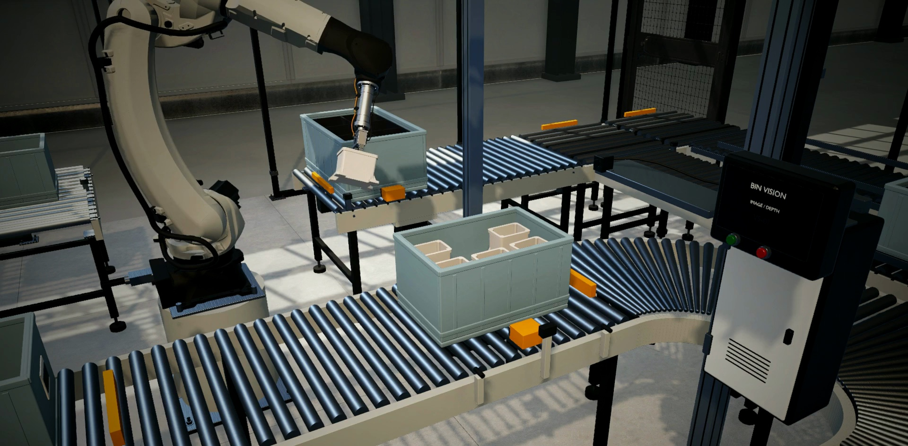
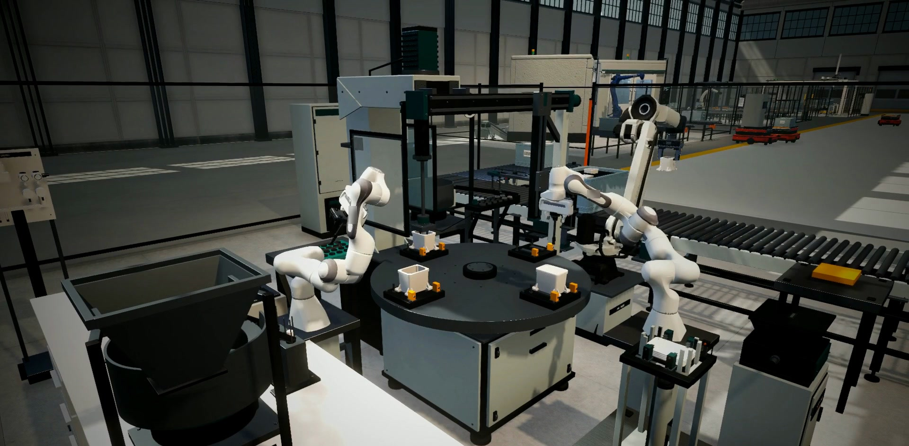
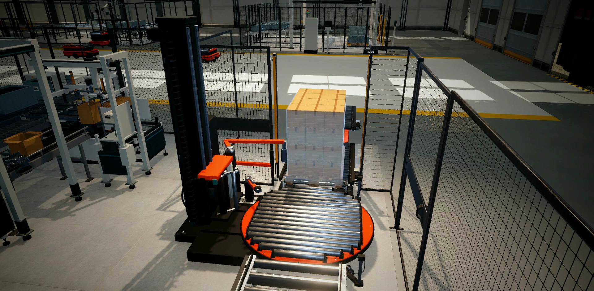

전시 부스에서 상영할 **가상 공장 시뮬레이션**과 **루프 영상**을 만든 프로젝트입니다.
특정 제조기업의 실제 설비를 옮긴 것이 아니라 전시를 위해 새로 설계한 부품 가공·조립 공장이며, 이 페이지의 이미지는 최종 영상의 실제 장면입니다(워터마크와 로봇 제조사 표기는 지우거나 잘라냈습니다).

## Overview

전시의 핵심 메시지는 **"로봇이 물리 법칙에 따라 움직인다"**였습니다.
원소재 입고부터 가공, 조립, 포장, 자동창고 입고까지를 하나의 공장으로 구성하고, 그 시뮬레이션을 연출 없이 그대로 촬영해 부스 화면에서 반복 재생했습니다.

- **씬 설계(9월):** AI로 만든 레퍼런스 이미지를 공정 관점에서 검토해 여섯 개 공정 구역을 설계하고, 시간 기반 애니메이션을 물리 기반 동작으로 전환했습니다.
- **영상 제작(10월):** 실제 시뮬레이션만 촬영한다는 원칙 아래 고정 스텝 캡처, 조명 개선, 스크립트 편집, 단계별 검수를 거쳤습니다.
- **결과물:** 상시 구동되는 공장 씬과 모니터링 화면, 약 2분 루프 영상과 3분 확장판(1920×1080, 30fps, 무음).

## Process

| 구역 | 역할 |
| --- | --- |
| 원소재 입고 버퍼 | 팔레트로 들어온 원소재 토트를 낱개로 풀어 순서대로 공급 |
| 비전 빈피킹 | 무작위로 담긴 부품을 하나씩 집어 정렬 토트에 배치 |
| 가공(머신 텐딩) | 로봇이 가공기 두 대에 소재를 장착·탈착. 라인의 속도를 정하는 병목 공정 |
| 로봇 조립 | 회전 인덱스 테이블에서 압입·적층·나사 체결 |
| 포장·팔레타이징·래핑 | 카톤 포장 후 흡착 그리퍼로 팔레트 적재, 필름 래핑. 실제 물리로 동작하는 구역 |
| 완제품 자동창고 | 스태커 크레인이 팔레트를 랙에 입고, 지게차로 출고 |

셀 사이는 토트 AMR, 팔레트 AMR, 지게차가 잇습니다. AMR은 한 방향 순환로로 정면 교행을 없앴고, 모든 셀은 같은 토트 규격과 인계 높이를 따르도록 했습니다.

## Design Principles

- **공정이 실제로 성립할 것.** 보기 좋은 배치보다 물건이 어떻게 넘어가는지를 먼저 설계했습니다.
- **물리적 근거를 가질 것.** 로봇은 공개된 관절 한계 안에서 움직이고, 흡착 파지는 힘의 계산으로 성공과 실패가 갈립니다.
- **구현된 것만 보여줄 것.** 데모용 가정은 실제 기능처럼 표현하지 않고, 영상도 리셋·배속·보간 없이 실제 시뮬레이션만 담았습니다.
- **관람객이 짧은 시간에 읽을 수 있을 것.** 소리 없이, 어느 지점에서 보기 시작해도 흐름이 이해되는 구성을 목표로 했습니다.

## Challenges and Solutions

| 과제 | 해결 |
| --- | --- |
| 레퍼런스 이미지가 공정으로는 성립하지 않음 | 공통 인계 규약을 정하고 셀을 재설계 |
| 씬에 물리 계산이 없음 | 동작을 세 등급으로 나누고, 메시지를 증명하는 팔레타이징 셀에 실제 물리 적용 |
| 실제 한계를 넘는 로봇 동작 | 관절 한계 기준으로 동작 시간을 늘리고 경유점을 부드럽게 연결 |
| 공정 교착과 긴 워밍업 | 대기열 분리·자동 해제, 초기 재공 배치와 연속 투입 |
| 화면 녹화의 프레임 불안정 | 엔진 시간을 고정해 촬영하는 고정 스텝 캡처 |
| UI를 유지하며 근접 장면 촬영 | 상태는 두고 표시만 끄는 최소 기능 추가 |
| 평평해 보이는 화면 | 셀 단위 조명 예산, 톤매핑 비교, 구도와 접촉 그림자 조정 |
| 루프 경계의 끊김 | 같은 연속 촬영본의 앞뒤 구간으로 시작과 끝 구성 |

자세한 과정은 이 프로젝트의 두 기록에 정리했습니다.

## Lessons

- 보기 좋은 그림보다 공정의 성립이 먼저입니다.
- 진짜는 메시지를 증명할 한 곳에 집중하고, 나머지는 한계를 정해 정직하게 남깁니다.
- 측정 가능한 소스를 먼저 확보한 뒤에 룩을 다듬습니다.
- 시뮬레이션이 해낸 일과 화면에 읽히는 일은 다릅니다. 구도로 증명합니다.
- 판정은 화면에 실제로 담긴 것으로 하고, 확인하지 못한 것은 그대로 기록합니다.
