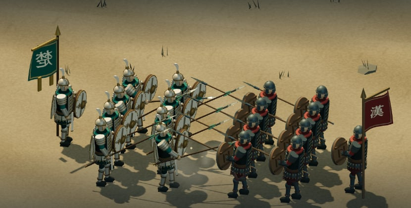
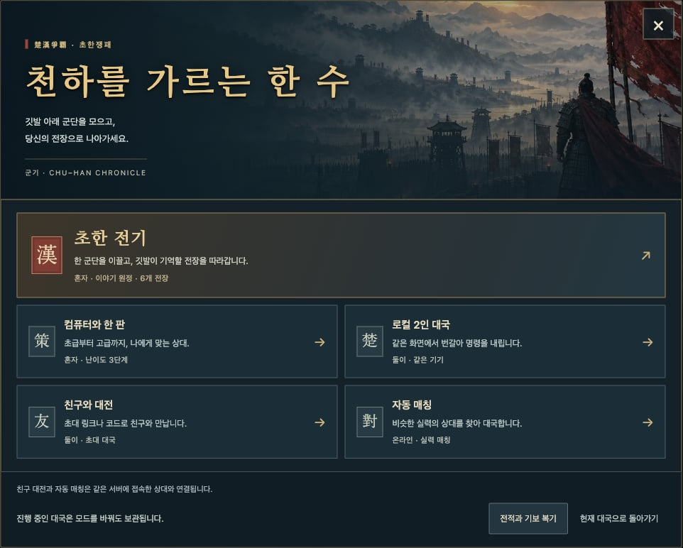
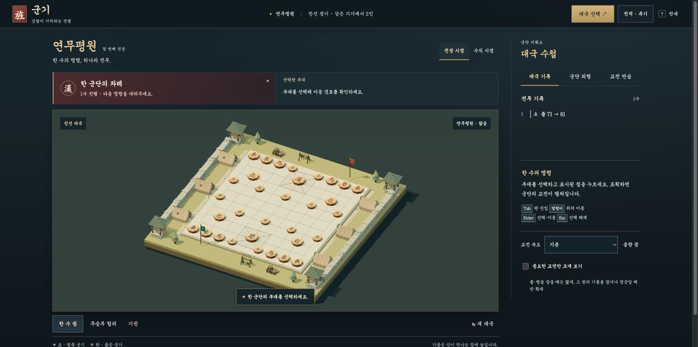
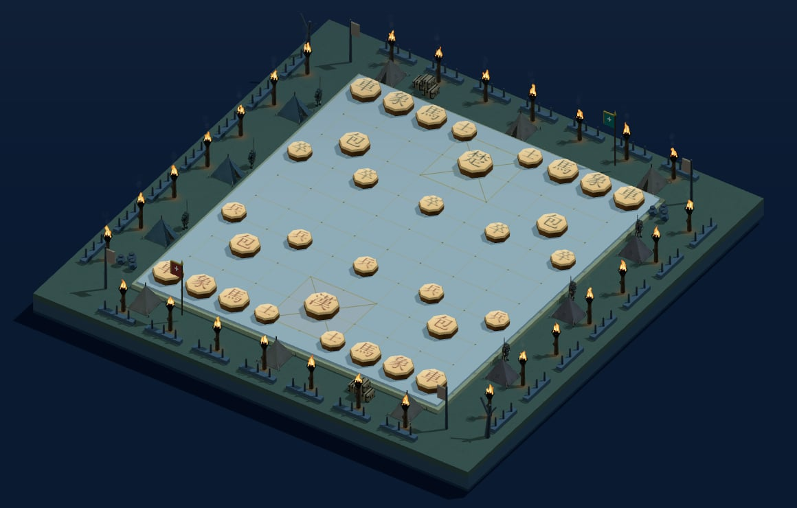
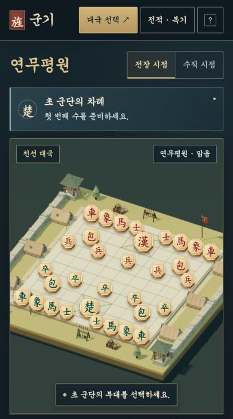

장기의 규칙은 그대로 두고, 기물이 잡히는 순간을 **두 군단의 교전 장면**으로 보여주는 게임입니다.
게임 엔진이나 npm 패키지 없이 브라우저와 Node.js만으로 실행됩니다.

## Game Modes

- **초한 전기** — 연무평원 → 진창 → 팽성 → 형양 → 성고·광무 → 해하로 이어지는 6개 전장 캠페인. 전장마다 버티기, 군량 수레 지키기, 수 제한 같은 임무가 있고, 클리어하면 군기를 받습니다.
- **컴퓨터와 한 판** — 초급·중급·고급 3단계. 최근 전적을 보고 다음 난이도를 추천합니다.
- **로컬 2인 / 친구와 대전** — 같은 기기에서 번갈아 두거나, 링크·코드로 친구를 초대합니다.
- **자동 매칭** — MMR이 가까운 상대와 연결합니다.
- **장기 배우기** — 처음 두는 사람을 위한 9단계 수업. 궁부터 상까지 행마를 하나씩 직접 둬봅니다.
- **군령전 (실험 중)** — 차례 없이 양쪽이 동시에 명령하는 실시간 장기 원형.

## Battlefields

기물은 두께와 모따기가 있는 팔각 목재 장기패로 만들고, 장기판 바깥에는 전장마다 다른 군영·성벽·횃불·보급품을 배치했습니다.

## Development

- **3D 렌더링**: Three.js로 장기판, 군단, 전장 소품을 직접 모델링하고 연출했습니다.
- **규칙 모듈**: 행마·장군·외통·빅장 판정을 하나의 순수 JS 모듈로 두고, 일반 대국·AI·복기·실시간 모드가 모두 같은 모듈을 씁니다.
- **AI**: 알파베타 탐색을 Web Worker에서 돌려 화면이 멈추지 않게 했습니다. 난이도는 탐색 깊이·노드 상한·후보 선택 폭으로 나눴습니다.
- **서버**: Node.js 서버 하나로 친구 대전, 자동 매칭, MMR, 전적 저장을 처리하고 Docker로 배포할 수 있게 했습니다.
- **테스트**: 규칙, AI, 캠페인, 실시간 모드 등을 `node --test`로 검증합니다.

## Mobile

휴대폰에서는 판을 위로 크게 배치하고, 터치한 곳에서 가장 가까운 교차점을 고르며, 주요 조작은 하단 막대에 모았습니다.

## Roadmap

지금까지는 게임의 뼈대와 콘텐츠를 넓히는 데 집중했다면, 다음 단계는 **완성도를 끌어올리는 디벨롭**입니다.

- **플레이테스트 기반 밸런싱** — 실제 플레이어 테스트로 6개 전장의 난이도 곡선, 임무 이해도, 이탈 지점을 검증하고 조정합니다.
- **비주얼 폴리싱** — 병종별 모델과 애니메이션 디테일, 라이팅, 이펙트를 다듬어 교전 연출의 완성도를 높입니다.
- **게임 필(Game Feel) 강화** — 타격감, 카메라 연출, 사운드 디자인을 보강해 한 수 한 수의 손맛을 살립니다.
- **UX 고도화** — 첫 플레이 온보딩, 모바일 조작감, 접근성을 개선합니다.
- **콘텐츠 확장** — 실시간 군령전을 정식 모드로 발전시키고, 천하 지도 전략 모드(천하쟁패)로 세계를 넓힙니다.
- **성능 최적화** — 저사양 휴대폰에서도 안정적인 프레임과 빠른 로딩을 확보합니다.
- **서비스화** — 공개 서버 운영과 안드로이드 앱 출시로 이어갑니다.
