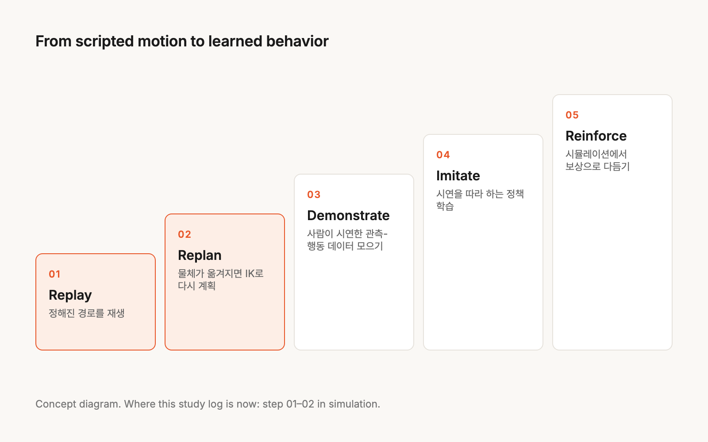

이 연재는 로봇 팔이 물건을 집어 옮기는 작은 과제 하나를 붙잡고, 시뮬레이션 → 로봇 제어 → 학습 → 현실 적용 순서로 공부한 기록입니다.
각 편은 공개 로봇 모델로 직접 돌려 본 실험과, 그 과정에서 알게 된 것을 담습니다. 1편부터 읽으면 흐름이 이어집니다.

피지컬 AI는 화면 속이 아니라 **물리 세계에서 보고, 판단하고, 움직이는 AI**입니다. 로봇 팔이 처음 보는 물건을 집거나, 이동 로봇이 사람을 피해 길을 바꾸는 일이 여기에 들어갑니다.
공장 디지털 트윈 작업을 하다 보니 "설비가 애니메이션이 아니라 물리로 움직이게" 만드는 일과 자연스럽게 이어졌고, 그 공부를 이 프로젝트에 모읍니다.

한 편으로 끝내지 않고, 공부하고 실험한 결과를 글로 하나씩 쌓아 갑니다.
실험은 개인 컴퓨터에서 **공개 로봇 모델**(MuJoCo Menagerie 등)로 직접 만들고, 측정한 숫자로 씁니다.

## Where I Am

지금은 위 그림의 1~2단계에 있습니다. 공개 로봇 모델로 상자를 손에 붙이지 않고 접촉과 마찰만으로 집어 옮기는 셀을 만들었고, 어떤 조건에서 놓치는지도 재 봤습니다.
학습된 정책은 아직 없습니다. 다음 목표는 사람이 시연한 관측-행동 데이터를 모으는 것입니다.

## Roadmap

- [x] 피지컬 AI 용어와 공부 지도 — 월드 모델, VLA, 시뮬레이터, sim2real
- [x] MuJoCo로 상자 집기 — 손에 붙이지 않고 마찰로 들기, 일부러 실패시키는 조건까지
- [x] 시뮬레이션 물성값은 어디서 구하나 — 마찰, 질량, 안전계수
- [ ] 순·역기구학과 자코비안 — 특이점 근처에서 무슨 일이 생기나
- [ ] 사람이 가르친 동작은 정책이 아니다 — teach 모드에서 모방학습까지
- [ ] 강화학습으로 reach·push 과제 학습하기
- [ ] Sim2Real — 시뮬레이션과 현실은 어디서 갈라지나, 도메인 랜덤화
- [ ] 게임 엔진과 물리 엔진 잇기 — 좌표계와 물리 소유권
- [ ] 가상 시운전 기초 — PLC 신호가 모터·컨베이어·센서를 거쳐 돌아오는 고리를 Python 가상 PLC로 재현
- [ ] OpenUSD와 디지털 트윈 — 디지털 트윈과 피지컬 AI가 만나는 곳
- [ ] VLA·월드 모델 논문 읽기

순서는 공부하면서 바뀔 수 있습니다. 글이 올라가면 이 목록과 아래 기록이 함께 늘어납니다.

## Principles

- 시뮬레이션에서 성공한 것을 "AI가 해냈다"고 쓰지 않습니다. 다시 계획한 것인지, 학습한 것인지 구분합니다.
- 실패도 기록합니다. 왜 안 됐는지가 다음 공부의 출발점이 됩니다.
- 숫자의 출처를 밝힙니다. 시뮬레이션 결과는 넣은 값만큼만 믿을 수 있습니다.
- 확인하지 못한 것은 확인하지 못했다고 씁니다.
- 실험은 공개된 로봇 모델과 공개 자료로 다시 만들어 기록합니다.
